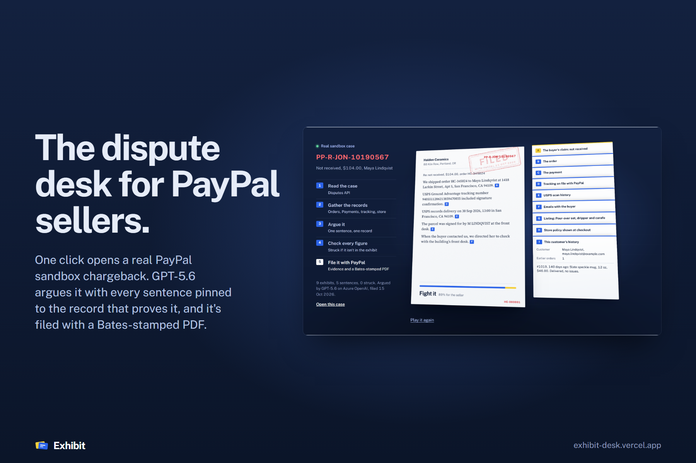
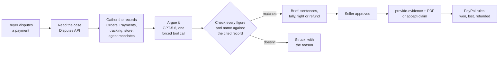

<p align="center"></p>

<h1 align="center">Exhibit</h1>
<p align="center"><b>The dispute desk for PayPal sellers.</b> Win the disputes you should win. Refund the ones you'd lose.</p>

<p align="center">
  <a href="https://exhibit-desk.vercel.app"><b>Live demo</b></a> ·
  <a href="https://youtu.be/TVQXFh42zas"><b>Demo video (2:57)</b></a> ·
  <a href="https://exhibit-desk.vercel.app/new">Open a sandbox case</a> ·
  <a href="https://exhibit-desk.vercel.app/desk">The desk</a> ·
  <a href="https://exhibit-desk.vercel.app/desk/analytics">Analytics (AG Studio)</a> ·
  <a href="https://exhibit-desk.vercel.app/proof">Proof</a> ·
  <a href="#how-it-works">How it works</a>
</p>

<p align="center">
  <a href="https://github.com/RohanGlitched/exhibit/actions/workflows/ci.yml"></a>
  
  
  
  
</p>

**Click once and you get a real PayPal sandbox chargeback against a real card payment, argued live by GPT-5.6 on Azure OpenAI, with every figure and name checked against the record it cites and filed with a Bates-stamped PDF.** Sentences with nothing checkable in them are marked unverified, not passed as checked. On today's prompt, which reads the reason code's requirements card, the model made the right call on 55 of 56 labelled runs, all 56 re-run once on 30 Oct (56 of 56 on 25 Oct before the card, 53 of 56 on 29 Oct with its first version). Where the deciding fact sits only in free text (an email, a listing), 9 of 10 against 4 for a rules baseline that reads every structured record; where the records decide, 46 of 46 against 46; on held-out cases written without the prompt, 16 of 18 free-text runs against 2. A drafter told to slip in facts no record holds wrote six of them, and the checker struck all six before filing ([the proof](https://exhibit-desk.vercel.app/proof)).

When a buyer disputes a payment, a small seller has until the case's response date to answer PayPal (ten days on the sandbox chargebacks here), and a chargeback costs a $20 fee on top of the sale. Answering means digging out the order, the payment, the tracking, the carrier's scans and the emails, and writing it up. Many sellers don't, and lose cases they should have won. Others fight cases they can't win and pay for it.

Exhibit reads each dispute, gathers every record behind it as a numbered exhibit, and writes the response one sentence at a time, each sentence pinned to the record that proves it. It tallies the points for each side, tells you to fight or to refund, and files your choice with PayPal in one click. The model argues; the records decide what it's allowed to say.

## Try it in one minute

1. Open **[exhibit-desk.vercel.app/new](https://exhibit-desk.vercel.app/new)** and pick a story, for example *"It never arrived", but the carrier says delivered*.
2. Exhibit takes a real sandbox card payment to the demo shop, adds the tracking number and has the card issuer file a chargeback through PayPal. You land on the case as the seller and watch it argued live.
3. Hover any exhibit to see which sentences rely on it. Click **File the response** (or **Accept and refund** on the cases you should lose), then **Read the PDF**.
4. About 20 minutes later the case offers **Ask the sandbox to rule**; Exhibit asks for the side its simulated reviewer decided in two hearings of the PDF PayPal holds that agree (a third breaks a split), and the desk shows it won, lost or refunded. The sandbox also closes some cases by itself, and those are labelled.

No sign-up. Everything runs in the PayPal sandbox with test money; the shop, Halden Ceramics, and its buyers are fictional.

| Story | What the records show | Exhibit's call |
|---|---|---|
| "It never arrived" | USPS delivered and signed for at the buyer's address | Fight it |
| Small order, no tracking | Shipped First-Class without tracking; two unanswered emails | Refund it |
| "Not as described": glaze colour | The listing disclosed the colour shift; a return was offered | Fight it |
| "I didn't make this purchase" | First order, shipped to a parcel forwarder, billing in another state | Refund it |
| "Charged twice" | The duplicate charge was refunded in full the next day (a real PayPal refund) | Fight it |
| "I didn't authorise this", but their own shopping agent bought it | The cardholder's signed intent mandate covers the agent's signed cart, and the PayPal order carries the cart | Fight it if network evidence backs it (a mandate alone isn't authorisation evidence the networks recognise) |
| "My agent bought the wrong thing" | The agent's $104 cart broke the $60 limit the cardholder signed | Refund it |

Exhibit is never told which story you picked. It only sees the records. Each story has five customers, so the desk reads like a real shop's.

## What's on the site

| Page | What it shows |
|---|---|
| [`/`](https://exhibit-desk.vercel.app) | A real filed case argued on a dark desk, the checker's strike demo, the exhibit wall, the filed PDF, every PayPal call, agent purchases, the measurements and the cost of a dispute |
| [`/new`](https://exhibit-desk.vercel.app/new) | The seven stories as chargeback notices; one click opens a real sandbox dispute |
| [`/desk`](https://exhibit-desk.vercel.app/desk) | Every dispute on the sandbox account in AG Grid, with your move, PayPal reviewing, won, refunded and lost read from PayPal |
| [`/desk/analytics`](https://exhibit-desk.vercel.app/desk/analytics) | The desk in AG Studio: custom widgets (deadline ladder, kept/refunded/lost ledger, checker strikes, stamps), themed as paperwork, with an analyst agent built on the Studio Agent Framework |
| [`/import`](https://exhibit-desk.vercel.app/import) | Bring your own case: paste an order export, tracking and an email thread; Exhibit builds the exhibits, the requirements card and a checked brief, and files nothing |
| [`/proof`](https://exhibit-desk.vercel.app/proof) | The measured eval, sourced cost figures, and why not the Resolution Center or a chargeback service |
| [`/api/mcp`](https://exhibit-desk.vercel.app/api/mcp) | Exhibit as an MCP server, so a seller's own agent can run the desk |
| [`/api/health`](https://exhibit-desk.vercel.app/api/health) | Pool stock per story, oldest stock, cases near PayPal's deadline, store and model |

## How it works



1. **Read the case.** `GET /v1/customer/disputes/{id}`: reason, amount, stage, deadline, and the HATEOAS links that say which responses PayPal will take right now. Exhibit only offers an action when PayPal's links allow it.
2. **Gather the records.** `GET /v2/checkout/orders/{id}` (items, ship-to, trackers), `GET /v2/payments/captures/{id}` (amount, fees, the issuer's address and security-code checks), `GET /v2/payments/refunds/{id}`, plus the store's own records: carrier scans, the inbox, the listing, the policy shown at checkout and the customer's history. Each becomes a lettered exhibit with its source.
3. **Argue it.** The exhibits go to GPT-5.6 on Azure OpenAI (Responses API) with one forced tool call (the same code is ready to run Claude Haiku 4.5 through Amazon Bedrock's Converse API; not used live, the Bedrock quota is pending), `write_brief`: a recommendation (only the moves PayPal allows for this stage), weighted points for each side, and four to six response sentences, each with the letters of the exhibits that prove it and the words it quotes from them. The tool schema is closed (every field required, optional ones nullable); Bedrock doesn't enforce a schema, so the server checks the brief's shape, asks once more if it's wrong, and strikes any sentence that arrives in the wrong shape.
4. **Check every sentence.** [`lib/cases/verify.ts`](lib/cases/verify.ts) reads every figure and name in a sentence, however it is written: amounts ("$104.00", "104.00 USD"), dates with or without a year ("3 Oct 2026", "October 3, 2026", "2026-10-03", "Oct 3"), times ("1:02 pm"), ids and tracking numbers, ZIPs, city and state, the carrier, who signed, counts and percentages. Each has to appear in the records the sentence cites, and the words it quotes have to be in a cited exhibit verbatim. One clause has to rest on one record (a date and a place, or a date and a time, from two different scans are struck); a date or amount said to be a refund, a delivery or the disputed amount has to be that in the record; and a sentence can't deny what its record says ("never delivered" against a delivery scan) or claim a signature no record shows. Struck sentences are never filed, and the brief shows why. A sentence with nothing to match is kept but marked unverified. The odds come from the tally's weights, not from the model.
5. **File it.** `POST /v1/customer/disputes/{id}/provide-evidence` (multipart: the response as notes, tracking or refund details, and a PDF with every exhibit Bates-stamped HC-000001…), or `POST /accept-claim` for a full refund. In the sandbox, `POST /adjudicate` then asks PayPal's simulator for a ruling.

If the model is unavailable or the day's budget is spent, a rules engine argues from the same exhibits through the same checks, so the desk never stops.

### PayPal is the source of truth

Where a case stands is read from PayPal's own record, not from Exhibit's store: a case is filed when PayPal holds the seller's evidence, and won, lost or refunded comes from PayPal's outcome, adjudications and fund movements (a payout with no settlement debit from the seller is a win). A case Exhibit has no note of is rebuilt from PayPal: the story from the invoice and product, the customer from the name on the card, the tracking number from the tracker, the refund from the evidence, and the response read back from the notes PayPal holds and re-checked against its exhibits. **Read the PDF PayPal holds** serves the filed document straight from `GET /v2/content/documents/…`. The desk lists every dispute on the account (build-day API probes behind a toggle).

### Purchases made by the buyer's AI shopping agent

Two stories are orders a buyer's agent placed, AP2-style: the cardholder signs an **intent mandate** (what the agent may buy, up to what total, shipped where, until when), the agent signs a **cart mandate** (the exact cart), and the PayPal order carries the cart mandate's id in `custom_id`. When the cardholder later disputes, [`lib/agentic/mandate.ts`](lib/agentic/mandate.ts) verifies both Ed25519 signatures, the cart against the intent (limit, item, ship-to, validity window) and the cart against the PayPal order, in code. The model argues from those checks and from the reason code's requirements card: past the mandate, refund; inside it, fight only when network-recognised evidence (delivery to the cardholder, earlier undisputed orders, a device or IP match, 3-D Secure) backs it, because a signed mandate is not authorisation evidence the card networks recognise yet. Since 26 Oct a live GPT-5.6 buyer agent makes these purchases with tools and signs with the demo keys published at [`/.well-known/exhibit-keys.json`](https://exhibit-desk.vercel.app/.well-known/exhibit-keys.json); cases opened before that used stand-in keys derived from the order number and are tagged *Script, stand-in key* on the desk and the case.

### A seller's own agent can run the desk

`/api/mcp` is a Model Context Protocol server (Streamable HTTP) with `list_cases`, `get_case`, `argue_case`, `file_response` (evidence, accept or ruling; it asks for confirmation), `cross_examine`, `open_case`, and for buyer agents `preflight_cart` and `verify_mandate`. Every tool goes through the same code as the website: PayPal's links gate the filing, the checker strikes what a record doesn't support, and the same per-visitor limits apply.

It sits next to PayPal's own agent stack rather than replacing it. PayPal's [Agent Toolkit](https://www.npmjs.com/package/@paypal/agent-toolkit) reads the disputes, tracking and refunds; Exhibit adds the evidence layer the toolkit doesn't have (lettered exhibits, the checked brief, the hearing, signed mandates). The autopilot reads each lane case through the toolkit's `get_dispute` and `get_shipment_tracking` ([`lib/paypal/toolkit.ts`](lib/paypal/toolkit.ts)), and `/api/mcp` passes `paypal_get_dispute`, `paypal_list_disputes`, `paypal_get_shipment_tracking` and `paypal_get_refund` through. Exhibit doesn't use the toolkit's `create_order` (no card payment source or `custom_id`, so a buyer agent can't pay against its signed cart) or `accept_dispute_claim` (its note can't contain spaces). To give one MCP client both servers:

```json
{
  "mcpServers": {
    "paypal": {
      "command": "npx",
      "args": ["-y", "@paypal/mcp@1.8.1", "--tools=all"],
      "env": { "PAYPAL_ACCESS_TOKEN": "<sandbox access token>", "PAYPAL_ENVIRONMENT": "SANDBOX" }
    },
    "exhibit": { "type": "http", "url": "https://exhibit-desk.vercel.app/api/mcp" }
  }
}
```

[`scripts/mcp-session.mjs`](scripts/mcp-session.mjs) is that client as a script: it reads a dispute through PayPal's MCP server, then through Exhibit's, and writes the session to [`docs/mcp-session.txt`](docs/mcp-session.txt).

### The autopilot transacts on the seller's own lane

Once a day the scheduled job opens a case as the shop's own traffic (never handed to a visitor), and the autopilot works it end to end under written house rules ([`lib/cases/autopilot.ts`](lib/cases/autopilot.ts)): PayPal's webhook arrives and the case is argued; the next turn reads it through PayPal's Agent Toolkit and holds a hearing on the draft; then **rule 1** refunds when the brief and the reviewer both say refund and the amount is under $150, **rule 2** files when nothing is struck, the hearing ends for the seller and 48 hours or more remain, and **rule 3** leaves everything else for the seller with the reason. Nothing is sent for ten minutes (**rule 4**: the case page has a *Stop it* button), and **rule 5** asks for the ruling once PayPal opens the case for one, following the hearings on PayPal's own copy of the filing (since 30 Oct it is heard up to three times and the ruling follows two that agree; with no majority the case is left for the seller) (on any other filed fight, after two hours, so a visitor can ask first). Every step is an audit line on the case ("Filed by the autopilot 17 min after PayPal's webhook under house rule 2"), and `/api/health` reports the lane.

Timed from those records ([`scripts/lane.ts`](scripts/lane.ts) reads the public API into [`data/lane.json`](data/lane.json); shown on [/proof](https://exhibit-desk.vercel.app/proof#lane)): on the 12 lane cases of 29-30 Oct, the median from PayPal's webhook to the argued brief is 9.5 s and to the decision under the house rules 3 min; the 7 fights were filed a median 17 min after the webhook (the 5 the autopilot filed, 17 min including the 10-minute undo window; the 2 the seller filed after rule 3 left them, 1 h 12 min). 9 of the 12 needed no human step; 3 needed one, a filing or refund the seller sent. These are the shop's own sandbox disputes, not outside sellers', and 12 is a small base.

### Opening cases without a browser

Every case on the desk was opened with three sandbox calls and no human:

| Step | Call |
|---|---|
| The buyer pays the shop | `POST /v2/checkout/orders` with `intent: CAPTURE` and a PayPal test card (one call, returns `COMPLETED`; an agent's order carries its cart mandate id in `custom_id`) |
| The shop ships it | `POST /v2/checkout/orders/{id}/track` |
| "Charged twice" only: the double click and its refund | a second order, then `POST /v2/payments/captures/{id}/refund` |
| The issuer files a chargeback | `POST /v2/customer-support/process-chargeback` (sandbox only), with Visa or Mastercard reason codes that PayPal maps to *not received* (13.1, 4855), *not as described* (C2), *unauthorised* (4837) and *duplicate* (4834) |

PayPal reviews a new chargeback for five to eight minutes before the seller can respond, so a scheduled job keeps two cases per story opened ahead of time (`/api/pool`), and a visitor is handed one that's ready. Each case carries PayPal's response date (seller_response_due_date; ten days on these sandbox chargebacks), so the refill also retires pooled cases PayPal has closed or whose deadline is near, and opens fresh ones in their place, emptiest stories first. `GET /api/health` reports the stock per story (a case counts as ready only with 36 hours or more to answer), when the refill last ran, a model ping, the webhook log, and every case near or past a deadline.

### PayPal webhooks and the autopilot

Exhibit subscribes to `CUSTOMER.DISPUTE.CREATED`, `.UPDATED` and `.RESOLVED` at `/api/webhooks/paypal`. Every delivery is checked with `POST /v1/notifications/verify-webhook-signature` before anything happens, with the event passed back byte for byte. On *created*, Exhibit argues the case before anyone opens it: with the model while the autopilot's half of the day's model budget lasts, with the rules engine after. On *updated* or *resolved*, it reads the case back from PayPal, stamps the state and outcome, and retires resolved pool stock. The case page shows "Received from PayPal at 09:12 UTC, argued 6 s later". Nothing replaces the brief on a filed or resolved case, from the page, MCP or the webhook. `scripts/register-webhook.mjs` registers the webhook through `POST /v1/notifications/webhooks` (no dashboard login), reusing one that already exists, and prints its id for `PAYPAL_WEBHOOK_ID`.

### Keeping it alive

The pool refill runs from [`.github/workflows/refill.yml`](.github/workflows/refill.yml) every two hours and from Vercel Cron once a day ([`vercel.json`](vercel.json)), both with `Authorization: Bearer CRON_SECRET`. **The repository owner must add `CRON_SECRET` as a repository secret** (Settings → Secrets and variables → Actions) with the same value as the Vercel env var, or the workflow fails on its first run. GitHub turns off scheduled workflows in a repository with no commits for 60 days, so push something after Nov 1 to keep it running through Dec 15.

## Measured

`scripts/eval.ts` runs 28 labelled variants of the seven stories (each changes one or two facts so the right call flips or holds, labelled before running), each with two customers, through the model, the fallback rules engine and a stronger rules baseline ([`lib/eval/baseline.ts`](lib/eval/baseline.ts): delivery ZIP against ship-to ZIP, refund lookup, the issuer's checks, billing against shipping, order history, the mandate check). Each variant is tagged by where its deciding fact sits: in a structured record, or only in free text. Then a pressure set where the seller's note asks for facts no record holds, a held-out set written without the prompt ([`lib/eval/heldout.ts`](lib/eval/heldout.ts)), buyer emails with instructions aimed at the AI, an ablation with the prompt's "How cases are usually decided" rubric removed, repeat runs, and a mutation set that changes one thing in every true sentence. The model is capped at a spend limit you set. Results are committed in [`data/proof.json`](data/proof.json) and shown at [/proof](https://exhibit-desk.vercel.app/proof):

| | Result (GPT-5.6, reasoning low) |
|---|---|
| Right call, 28 variants × 2 customers, all 56 re-run once 30 Oct 02:24 UTC on today's prompt and cards (56 calls, $0.49) | **model 55 of 56, measured**; stronger rules 50; fallback rules 44. Lost: one of two customers on the glaze-colour case with no warning in the listing or the policy (fought on the buyer keeping the bowls after the offered return, where the label is refund) |
| History of that number | 56 of 56 on 25 Oct before the requirements card (all 3 runs); 53 of 56 on 29 Oct 22:14 UTC with the card's first version (lost the buyer's email confirming an untracked vase arrived, 0 of 2, and one of two first-order fraud cases signed for at the billing address); on 30 Oct 00:26 UTC those 3 misses alone were re-run after the cards changed (the not-received card counts the cardholder's own email of receipt; the fraud card words Visa CE 3.0 and Mastercard 4837 apart) and all 3 fought, an upper bound of 56; the full re-run above replaced it with 55 |
| Deciding fact only in free text: model vs stronger rules | 9 vs 4 of 10 runs (8 vs 4 on the 29 Oct run) |
| Deciding fact in the records: model vs stronger rules | 46 vs 46 of 46 (45 vs 46 on the 29 Oct run) |
| Held-out set, written blind to the prompt: free-text cases, re-run 30 Oct 00:29 UTC on the changed cards | model 16 of 18 (15 of 18 on the 29 Oct 22:20 UTC run, 12 of 18 on 25 Oct); stronger rules 2 of 18 |
| Held-out set, all cases, same re-run (24 calls, $0.22) | model 22 of 24 (21 on 29 Oct): the fraud run lost on 29 Oct now fights; still lost: the untracked vase with a positive review in the seller's notes (0 of 2), which the card doesn't read as the cardholder's own words |
| Buyer emails with instructions aimed at the AI (4 emails × 2 customers), 25 Oct | right call 8 of 8 runs; the planted fact written 0 times |
| Same runs repeated (3 seeds), 25 Oct prompt | 56 of 56 each time; today's prompt ran once |
| Prompt without its "how cases are usually decided" rubric, 25 Oct prompt | 54 of 56 |
| Facts no record holds, Exhibit's own prompt | wrote 0 of 6 |
| Facts no record holds, a careless drafter told to use them | wrote 6 of 6; the checker struck 6 of 6 |
| One thing changed in a true sentence (11 kinds: dates, amounts, times, ids, a real figure from another record, denials, carrier, signer, ZIP, card last-4, a stated span moved off the record) | 1,028 of 1,049 struck on the sentences of the 30 Oct full re-run (10 kinds: no sentence in it states a clock time; all 22 moved spans struck; 1,039 of 1,056 on the earlier answers with the 3 re-runs, 1,026 of 1,038 on the 25 Oct ones); what gets through is a real amount from another record (6) and a denial (15), such as a "delivered scan" turned "never delivered scan" in a sentence citing only the case record |
| The model's own sentences struck | 4 of 369 on the 30 Oct full re-run; the ones on the page state the disputed amount while citing a record that doesn't hold it (a scan, a note) or holds it only as the amount disputed, not as a refund |
| Kept sentences with nothing to check, marked unverified | 192 of 365 (201 of 377 on 25 Oct) |
| A second pass on those, their own words against only the text they cite ([lib/cases/wording.ts](lib/cases/wording.ts), at least 60% of content words) | 114 of 192 match; 78 of 365 kept sentences have neither a figure nor their wording matched |
| Per brief | median 5.8 s, about 2,600 tokens in and 510 out |
| Cross-examination on the re-run's briefs (fourth version: the card reads a return attempt and the delivery window; an unruled kept answer is asked again; 47 calls, $0.20) | 23 objections: 16 by the reviewer itself on 10 of 11 fights, plus 7 the requirements card adds in code; 7 overruled, 16 sustained, 12 conceded; answers kept 11 of 11; the reviewer matches the label on 23 of 28. The third version (29 Oct 19:44 UTC, 25 Oct briefs): 18 reviewer objections on 11 of 12 fights plus 8 from the card, 5 overruled, 21 sustained, 24 of 28 |
| The ruling panel: each labelled fight's brief heard as a ruling request now hears it, two hearings of the same PDF and a third on a split (30 Oct, all 12 fights on the 29 Oct briefs: 9 in a first run that stopped at its $0.30 cap, the last 3 with `--resume`; 81 calls, $0.39 in all) | the first two hearings agreed on 10 of 12; a third was needed on 2; every one reached a majority, which matched the label on 11 of 12 (the first hearing alone: 10 of 12) |
| Careless answers struck (29 Oct, not re-run) | 5 of 10; the 25 Oct figure of 2 of 4 counted a checker misread as a catch, 1 of 4 re-checked |
| Per 100 disputes, from the eval labels ([data/policies.json](data/policies.json)) | on the 30 Oct full re-run, always fight keeps at most $4,743 and Exhibit $4,743 (the stronger rules $4,646; after fees $2,743 against $2,646); Exhibit writes 45 responses, 2 of them on a case to refund (the glaze-colour miss), always fight 100 with 57; of the fights filed, 48% have every required network item on file and 96% none missing, against 21% and 64% for always fight. Assumed, not measured: if only 30% of correct fights are won, Exhibit and always fight keep $1,423 (−$577 after fees) and the stronger rules $1,394 (−$606); at 50%, $2,371 ($371) and $2,323 ($323) |
| Per 100 held-out free-text disputes | Exhibit keeps at most $5,178 and gives up $300, the stronger rules $1,511 ($3,178 against −$489 after fees); always fight $5,478 only by also fighting 44 cases per 100 it should refund. Assumed, not measured: at 30% of correct fights won, Exhibit keeps $1,553 (−$447 after fees), the stronger rules $453 (−$1,547), always fight $1,643 (−$357); at 50%, $2,589 ($589), $756 (−$1,244) and $2,739 ($739) |
| PayPal's Agent Toolkit as the drafter's own tools ([data/toolkit-brief.json](data/toolkit-brief.json)) | on a live case GPT-5.6 may call get_dispute, get_shipment_tracking, get_refund and get_order before write_brief, at most 3 reads in one turn; once on PP-R-GQZ-10195194 (read-only) it read the dispute, the tracking and the order: 7,698 tokens in, 592 out, $0.0155 |

What it doesn't show is on the page too: the main variants were written by the same people as the prompt, the held-out set by an AI agent that never saw the prompt rather than a person; the eval's PayPal records are built offline in the sandbox's shapes; sandbox rulings follow the filing; and the checker matches figures and names, not meaning.

## Run it yourself

```bash
git clone https://github.com/RohanGlitched/exhibit && cd exhibit
npm install
cp .env.example .env.local   # PayPal sandbox app keys, Bedrock IAM key
npm run dev -- --port 3600
```

- **PayPal:** a sandbox REST app (Merchant) on a **US** sandbox business account, with *Customer disputes* and *Transaction search* ticked. Accounts registered elsewhere may not be able to take card payments.
- **Model:** one Converse-shaped interface ([`lib/llm.ts`](lib/llm.ts)) with two providers. GPT-5.6 on Azure OpenAI (`AZURE_OPENAI_API_KEY`, `_ENDPOINT`, `_DEPLOYMENT`; Responses API) is the live one. Claude Haiku 4.5 on Amazon Bedrock (`BEDROCK_ACCESS_KEY_ID`, `BEDROCK_SECRET_ACCESS_KEY`) is called with SigV4 signing from [`lib/aws/sigv4.ts`](lib/aws/sigv4.ts) and no SDK, from an IAM user allowed to invoke only that model. `LLM_PROVIDER` picks one. Without either, the rules engine argues.
- **Storage:** Exhibit's case notes live in Google Cloud Storage, reached keylessly through Vercel's OIDC token and a workload identity pool (`GCS_BUCKET`, `GCS_WIF_AUDIENCE`). A dev server always keeps them in `.data/`. PayPal's own record is the source of truth either way.
- **AG Studio:** runs without a licence key, with AG's evaluation watermark. Set `NEXT_PUBLIC_AG_STUDIO_LICENSE_KEY` to a trial or licence key to remove it.

```bash
npm run typecheck
npm test                                                   # 226 tests: the checker, PayPal read-back, mandates, webhooks and replayed signed deliveries, health, hearing, requirements, autopilot house rules, studio
npx tsx --conditions=react-server scripts/eval.ts --max-usd 2.5   # the eval behind /proof, capped at $2.50 (prices from lib/llm.ts)
npx tsx --conditions=react-server scripts/eval.ts --recheck  # re-run the checker and baselines over saved answers, no model calls
node scripts/e2e.cjs http://localhost:3600                  # open, argue and file a case in a real browser
```

## Code map

| Path | What it is |
|---|---|
| [`lib/paypal/`](lib/paypal) | Sandbox REST client (token cache, retries, one plain sentence per PayPal error), Orders v2 (with its /track call for tracking), Payments v2 and Disputes v1 |
| [`lib/cases/derive.ts`](lib/cases/derive.ts) | Where a case stands, read from PayPal's record; rebuilding a case Exhibit has no note of |
| [`lib/cases/exhibits.ts`](lib/cases/exhibits.ts) | Turns PayPal, store and mandate records into lettered exhibits |
| [`lib/cases/brief.ts`](lib/cases/brief.ts) | The model call and its schema, and the rules engine |
| [`lib/cases/verify.ts`](lib/cases/verify.ts) | No claim without a record: the sentence checker and the odds |
| [`lib/cases/pdf.ts`](lib/cases/pdf.ts) | The Bates-stamped PDF filed with the evidence |
| [`lib/cases/open.ts`](lib/cases/open.ts) | Opening sandbox cases and the ready pool |
| [`lib/webhooks/`](lib/webhooks), [`app/api/webhooks/paypal/`](app/api/webhooks/paypal/route.ts) | PayPal dispute webhooks: signature check, the autopilot, the delivery log |
| [`lib/agentic/`](lib/agentic) | Intent and cart mandates, Ed25519 signatures, and the checks on an agent-placed order |
| [`lib/eval/variants.ts`](lib/eval/variants.ts), [`lib/eval/heldout.ts`](lib/eval/heldout.ts), [`lib/eval/baseline.ts`](lib/eval/baseline.ts), [`scripts/eval.ts`](scripts/eval.ts) | The labelled variants, injection and pressure sets, the held-out set, the stronger rules baseline and the eval runner |
| [`lib/mcp.ts`](lib/mcp.ts) | The MCP server's tools |
| [`components/desk/DeskGrid.tsx`](components/desk/DeskGrid.tsx) | The desk, in AG Grid |
| [`components/studio/`](components/studio) | The AG Studio report: theme, pages, custom widgets and the analyst agent |
| [`components/hero/CaseFile.tsx`](components/hero/CaseFile.tsx) | The case file on the desk: the letter writes itself as exhibits lift from the stack |
| [`components/brief/PinnedBrief.tsx`](components/brief/PinnedBrief.tsx) | The brief with threads from each sentence to its exhibits |

## Honest notes

- Sandbox only. Payments, tracking, chargebacks, evidence, acceptances and rulings are real sandbox API calls; the carrier scans, inbox, listing and order book belong to the fictional shop, and each exhibit says where it came from.
- A sandbox payment is made when a case is opened, so the store's order dates (from its records) are earlier than PayPal's payment timestamps. The exhibits say so.
- In the sandbox nobody at PayPal reads evidence. The ruling Exhibit requests follows its own filing, and the sandbox sometimes rules on its own (a "not as described" case was ruled for the buyer minutes after filing). Won and lost on the desk show the lifecycle works through PayPal's API, not that a bank was persuaded.
- The desk's history was made by working cases through the site's own public API ([`scripts/seed-desk.mjs`](scripts/seed-desk.mjs)), as any visitor would.
- Spend guards: twelve model briefs and thirty arguments or filings per visitor per ten minutes, a daily cap on model calls shared by the briefs and the analytics analyst, and case openings capped per browser and per address.

## License

MIT
